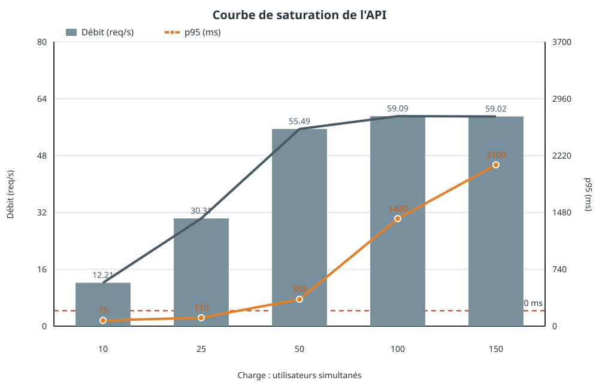

# velov-mlops

Projet fil rouge du cours **Industrialisation de l'IA dans le Cloud** (M2 Data Engineering / IA).

Objectif métier : prédire, pour chaque station Vélo'v, le nombre de vélos disponibles **dans une heure**,
et servir cette prédiction via une API fiable, conteneurisée, puis déployée (on-premise et cloud).

## Progression par session

Chaque étape du cours correspond à un tag git. Absent ou bloqué : repartez du tag de fin de la session précédente.

| Tag | Contenu |
|---|---|
| `s1-start` | Données simulées, features, entraînement. API à compléter (TP1) |
| `s1-end` | Modèle v0 servi par FastAPI, tests pytest |

```bash
git checkout s1-end          # récupérer l'état de fin de S1
git checkout -b mon-binome   # travailler sur sa propre branche
```

## Démarrage rapide

Prérequis : Python 3.11+ (3.12 recommandé), git et Docker Desktop.

```bash
python -m venv .venv
source .venv/bin/activate            # Windows : .venv\Scripts\activate
pip install -r requirements-dev.txt
pip install -e .                     # rend le package velov importable

python -m velov.data                 # génère data/velov_history.csv (simulateur, seed fixe)
python -m velov.train                # entraîne et écrit models/model.joblib + models/metadata.json
docker compose up -d                 # démarre PostgreSQL, MLflow et l'API
python -m velov.train --mlflow       # idem + journalisation MLflow
pytest                               # tests
uvicorn velov.api.main:app --reload  # API sur http://127.0.0.1:8000/docs (--reload : en dev uniquement)
```


Après `docker compose up -d`, l'interface MLflow est disponible sur
http://localhost:5000. Le service PostgreSQL conserve les prédictions de l'API
dans `velov_db` et les métadonnées MLflow dans une base séparée `mlflow`.
Le service `mlflow-db-init` crée et migre les tables MLflow avant le démarrage
du serveur. Les artefacts sont conservés dans le volume Docker
`mlflow_artifacts`.

Depuis la machine hôte, le client d'entraînement utilise :

```powershell
$env:MLFLOW_TRACKING_URI = "http://localhost:5000"
python -m velov.train --mlflow
```

Depuis un conteneur du Compose, l'URL interne est `http://mlflow:5000`.

Avec l'option `--mlflow`, chaque run conserve :

- les paramètres du modèle (`model_version`, `test_days`, `seed`, `learning_rate`,
  `max_iter`) ;
- les métriques de test (`mae_model`, `mae_baseline_persistence`,
  `mae_model_peak_hours`) ;
- le commit et l'état du dépôt dans les tags `git_commit` et `git_dirty` ;
- l'empreinte SHA-256 et la période des données dans les tags `data_sha256`,
  `data_period_start` et `data_period_end` ;
- le modèle MLflow sérialisé avec sa signature ;
- le paquet reproductible `model-package/`, contenant les fichiers locaux
  `model.joblib` et `metadata.json`.

### Préparer la mesure de charge (TP5)

La mesure de référence porte sur `POST /v1/predict`. Elle utilise le modèle
chargé et le chemin complet de l'API, y compris l'écriture de la prédiction
dans PostgreSQL lorsqu'une `DATABASE_URL` est configurée. Le scénario Locust
est dans `locustfile.py` et réutilise toujours le même payload valide.

Pour une campagne de mesure, l'API doit être lancée sans rechargement de code,
avec un seul worker Uvicorn et une limite Docker d'un cœur. Ces réglages sont
définis dans le service `api` de `docker-compose.yml`. Locust reste lancé sur
la machine hôte, à côté du conteneur API, afin que la limite CPU mesure bien le
service testé et non le générateur de charge.


Le test court ci-dessous est un smoke test avant toute campagne plus longue :
`/ready` doit répondre `200`, Locust doit afficher `0` requête échouée, et les
fichiers CSV/HTML doivent être conservés localement. Pour une campagne
reproductible, noter le commit, le modèle, le nombre d'utilisateurs, le débit
de lancement, la durée, le nombre de workers et la limite CPU. Les résultats
Locust donnent notamment le débit, le taux d'erreur et les percentiles p50,
p95 et p99 de latence.
Dans PowerShell, après avoir créé `.env` et généré le modèle :

```powershell
docker compose up -d --build
Invoke-WebRequest http://127.0.0.1:8000/health
Invoke-WebRequest http://127.0.0.1:8000/ready
python -m pip install -r requirements-dev.txt
New-Item -ItemType Directory -Force locust-results
locust --headless --locustfile locustfile.py `
  --host http://127.0.0.1:8000 `
  --users 10 --spawn-rate 2 --run-time 1m `
  --csv locust-results/tp5-smoke --html locust-results/tp5-smoke.html
docker compose ps api
docker compose down
```

### Courbe de saturation TP5

La campagne complète mesure cinq paliers de charge après une minute
d'échauffement : 10, 25, 50, 100 et 150 utilisateurs simultanés. Chaque
palier dure deux minutes et produit les fichiers bruts Locust dans
`locust-results/tp5-saturation`. Le scénario vérifie le statut HTTP et le
contrat JSON de chaque prédiction ; une réponse invalide est donc comptée
comme une erreur.

L'API doit rester sur un worker et un cœur (`docker-compose.yml`). Locust doit
rester sur la machine hôte. Depuis PowerShell, avec l'API prête :

```powershell
.\loadtest\paliers.ps1
```

Les paramètres peuvent être adaptés sans modifier le protocole de référence :

```powershell
.\loadtest\paliers.ps1 -HostUrl http://127.0.0.1:8000 `
  -ResultsDirectory locust-results\tp5-saturation
```

Le rapport `saturation-summary.md` et le graphique `saturation-summary.svg`
sont générés automatiquement. La capacité sous le SLO est le débit du
dernier palier dont le p95 reste inférieur à 200 ms et dont le taux d'erreur
reste inférieur à 0,1 %. Le rapport indique aussi le premier palier qui
dépasse le SLO. Les résultats doivent être accompagnés dans le rendu du
commit, du modèle, de la machine, des versions, de la limite CPU et de
l'heure de mesure.

#### Résultats de la mesure

Campagne réalisée le 17 novembre 2026 avec un worker Uvicorn, une limite API
d'un cœur, Locust sur la machine hôte et zéro erreur HTTP ou de contrat :

| Utilisateurs | p50 (ms) | p95 (ms) | p99 (ms) | Débit (req/s) | Erreurs | SLO |
|---:|---:|---:|---:|---:|---:|:---:|
| 10 | 61 | 75 | 94 | 12,21 | 0,000 % | Respecté |
| 25 | 64 | 110 | 170 | 30,31 | 0,000 % | Respecté |
| 50 | 100 | 350 | 560 | 55,49 | 0,000 % | Dépassé |
| 100 | 940 | 1400 | 1600 | 59,09 | 0,000 % | Dépassé |
| 150 | 1700 | 2100 | 3000 | 59,02 | 0,000 % | Dépassé |

La capacité mesurée sous le SLO est donc de **30,31 req/s au palier de
25 utilisateurs**. Le premier dépassement apparaît à 50 utilisateurs, avec
un p95 de 350 ms. La courbe complète est disponible dans
[`saturation-summary.svg`](locust-results/tp5-saturation/saturation-summary.svg)
et le tableau détaillé dans
[`saturation-summary.md`](locust-results/tp5-saturation/saturation-summary.md).



Une campagne ciblée à 50 utilisateurs a également servi à documenter les
ressources au moment de la saturation. Elle a mesuré un p95 de 540 ms,
un débit de 51,32 req/s et zéro erreur. Les échantillons `docker stats`
montrent un CPU API jusqu'à 94,16 % et environ 164 MiB de mémoire, tandis que
le processus Python enfant de Locust est resté sous 15 % CPU. Ces mesures
confirment que le goulot est l'API, et non le générateur de charge :
[`tp5-api-stats-50-users.txt`](evidence/tp5-api-stats-50-users.txt),
[`tp5-locust-stats-50-users.txt`](evidence/tp5-locust-stats-50-users.txt) et
[`saturation-summary.md`](locust-results/tp5-saturation-50/saturation-summary.md).

### Intégration continue

Le workflow GitHub Actions `.github/workflows/ci.yml` est exécuté sur chaque
push vers `tp4`, `main` ou `master`, ainsi que sur chaque pull request. Il
effectue :

- le lint Ruff sur `src/` et `tests/` ;
- les tests unitaires et les tests du modèle, avec `pytest -m "not integration"` ;
- un scan Gitleaks pour détecter les secrets accidentellement commités.

Le test `tests/test_mlflow_stack.py` est marqué `integration` et reste exclu de
la CI standard car il nécessite Docker Compose et un fichier `.env` local. Il
se lance séparément avec :

```bash
pytest tests/test_mlflow_stack.py -m integration
```

Les actions GitHub utilisées par le workflow sont épinglées sur un commit SHA
complet afin de garantir une exécution reproductible et d'éviter qu'une mise à
jour externe imprévue ne modifie le comportement de la CI.

La métrique `mae_model_peak_hours` est la MAE du modèle sur les observations du
jeu de test dont l'heure locale à Lyon est une heure de pointe : 07:00–09:59
ou 17:00–19:59 (`Europe/Paris`). Les heures sont calculées sur le timestamp de
l'observation, avant conversion éventuelle de l'affichage en UTC.

### Registre MLflow et promotion

Un run terminé peut être enregistré comme nouvelle version du modèle et recevoir
l'alias `challenger` :

```powershell
$env:MLFLOW_TRACKING_URI = "http://localhost:5000"
python -m velov.registry --run-id <run-id>
```

La décision de promotion se fait ensuite avec :

```powershell
python -m velov.promote
```

Cette commande est un dry-run : elle vérifie la fenêtre d'évaluation, la
comparaison à la persistance et le gain minimal de 2 % sur le champion, puis
affiche la décision sans modifier le registre. Après validation humaine, le
même opérateur peut appliquer une décision positive avec :

```powershell
python -m velov.promote --apply
```

`--apply` ne rend pas la décision automatique : il autorise uniquement le
déplacement explicite de l'alias `champion` vers le challenger si la règle
autorise la promotion. L'interface MLflow sert à consulter les runs, métriques,
tags et versions ; la commande est le point d'application contrôlé de la règle.

Chaque décision est auditée sur le run challenger avec les tags
`promotion_decision`, `promotion_reason`, `promotion_previous_champion` et
`promotion_rule_version`. Une décision positive en dry-run est marquée
`eligible`, puis devient `promoted` seulement après `--apply`; une décision
négative est marquée `rejected`.

#### Règle de promotion

Le modèle enregistré s'appelle `velov-availability`. Il s'agit du nom de la
famille dans le Model Registry ; chaque version numérotée correspond à un run
MLflow et à un modèle entraîné concret.

- `challenger` désigne la version candidate à évaluer.
- `champion` désigne la version actuellement retenue comme meilleure version.
- Les deux versions doivent avoir été évaluées sur exactement la même fenêtre,
  enregistrée par `evaluation_period_start` et `evaluation_period_end`. La
  fenêtre par défaut est constituée des 14 derniers jours du jeu de données,
  mais sa durée est le paramètre `test_days`.
- Le challenger doit battre la baseline de persistance :
  `mae_model < mae_baseline_persistence`.
- S'il existe déjà un champion, le challenger doit aussi améliorer sa MAE d'au
  moins 2 % :
  `challenger_mae <= champion_mae * 0.98`.
- Sans champion, un challenger qui bat la persistance devient éligible comme
  premier champion.

La différence entre deux seeds du même modèle mesure la variabilité
expérimentale. Elle aide à justifier un seuil supérieur au bruit observé, mais
elle ne remplace pas la règle fixe de 2 % et ne sert pas directement de seuil
de promotion.

La commande `python -m velov.promote` effectue un dry-run et n'affecte aucun
alias ; l'opérateur peut examiner la décision dans la sortie et les tags du run.
Après validation, `python -m velov.promote --apply` réévalue la règle et déplace
explicitement l'alias `champion` si la décision est positive. L'interface MLflow
sert à consulter les runs, métriques, tags, artefacts et alias ; la commande
contrôle leur modification.

### Vérifier la stack MLflow localement

Après avoir créé `.env` à partir des variables documentées (ce fichier reste
ignoré par Git), lancez le test d'intégration avec pytest :

```bash
pytest tests/test_mlflow_stack.py -m integration
```

Ce test vérifie l'interpolation Compose sans afficher les secrets, l'état de
PostgreSQL et des migrations MLflow, les endpoints HTTP MLflow, la présence de
la base MLflow et la conservation des métadonnées après un redémarrage du
serveur. Le résultat reproductible est écrit dans
`evidence/mlflow-local-stack.txt`.

### Ingestion des données réelles

Le projet sépare les fonctions de téléchargement dans `velov.ingest` des deux
orchestrations qui les utilisent :

```bash
# Reconstituer les 90 derniers jours disponibles pour l'entraînement
python -m velov.build_training_data --days 90 --output-dir data/bronze

# Collecter un seul lot temps réel (à planifier toutes les cinq minutes)
python -m velov.run_microbatch --output-dir data/bronze
```

Le premier parcours l'API historique Vélo'v jour par jour, suit sa pagination,
enregistre les réponses JSON brutes et déduplique les lignes normalisées avec
`(station_id, timestamp)`. Il récupère aussi la météo horaire historique
d'Open-Meteo. Le relancer reconstruit la fenêtre à partir de la date la plus
récente réellement publiée par la source et ne crée pas de doublons.

Le second lit le flux GBFS courant et la météo récente. Le planificateur
externe doit lancer cette commande toutes les cinq minutes. Les sorties sont
écrites dans `data/bronze/` (répertoire ignoré par git).

Les fonctions partagées de `velov.ingest` récupèrent et normalisent également
les informations de stations, l'état des stations et la météo lorsque ces
fonctions sont utilisées par un orchestrateur.

Les observations temps réel sont conservées en bronze puis agrégées en heures
dans le pipeline dbt. Leur clé d'idempotence est `(station_id, last_reported)`.
La clé d'une ligne historique est `(station_id, timestamp)`.

Exemple d'appel :

```bash
curl -X POST http://127.0.0.1:8000/v1/predict \
  -H "Content-Type: application/json" \
  -d '{"station_id": 3, "timestamp": "2026-10-06T08:00:00+02:00", "capacity": 20,
       "bikes_available": 12, "temperature": 14.5, "is_raining": false}'
```

Le `timestamp` doit porter un fuseau (`+02:00`, `Z`...) : sans fuseau, l'API répond 422.
Les instants sont renvoyés et journalisés en UTC (`"target_timestamp": "2026-10-06T07:00:00Z"`).

## Exigences du projet

Le service doit respecter les exigences de [docs/exigences.md](docs/exigences.md), de S1 à S9.
Chaque rendu indique celles qu'il couvre et comment le vérifier.

### Pipeline TP3

Le pipeline suit les couches médaillon :

```text
data/bronze/ (JSON source conservés tels que reçus)
    -> velov_dbt/models/staging/ (silver typé et dédoublonné)
    -> velov_dbt/models/marts/station_hourly.sql (gold horaire sous contrat)
    -> dbt tests (qualité et absence de fuite temporelle)
    -> train.py --gold-db data/velov.duckdb (validation Pandera avant entraînement)
```

Depuis la racine du dépôt, après installation des dépendances de développement :

```bash
cd velov_dbt
dbt build --vars '{"bronze_path": "../data/bronze"}'
python -m velov.train --gold-db data/velov.duckdb
```

Le modèle gold est publié uniquement si son contrat dbt et ses tests passent.
La preuve de l'idempotence bronze se trouve dans
[evidence/bronze-idempotency.txt](evidence/bronze-idempotency.txt).

> **Politique de seuil à revoir :** le test `bikes_within_capacity` est
> actuellement bloquant : une seule ligne invalide fait échouer `dbt build` et
> empêche la publication de la table gold. Les diapositives du TP3 mentionnent
> une politique possible avec les seuils `warn_if`/`error_if` (par exemple, un
> avertissement pour un petit nombre d'anomalies). Cette politique n'est pas
> encore activée, car EX-12 interdit de publier une table gold invalide. Il
> faudra la revoir à la lumière des exigences métier et pédagogiques avant de
> la modifier.


## Structure

```
src/velov/
  data.py          simulateur de données (remplacé par l'open data en S3, même schéma)
  ingest.py        fetchers et parseurs partagés
  build_training_data.py  backfill historique et fenêtre d'entraînement
  run_microbatch.py        collecte d'un lot temps réel
  features.py      features partagées entraînement / API (anti training-serving skew)
  train.py         entraînement, baseline, artefact + metadata.json, option MLflow
  api/main.py      FastAPI : /health, /ready, /v1/model, /v1/predict, /v1/predict/batch
  api/schemas.py   contrat d'entrée / sortie (Pydantic)
tests/             pytest (features, API)
docs/              templates : model card, runbook, ADR
exercices/         démo pickle (S1)
```

Sur Windows, `run_microbatch` peut être lancé par le Planificateur de tâches
toutes les cinq minutes. Cela ne collecte rien pendant l'arrêt ou la veille de
la machine ; pour une série continue, déployer la même commande sur une VM
allumée en permanence. Une exécution manuelle reste utile après une période
d'arrêt, car l'idempotence évite les doublons lors d'un rattrapage.

## Usage de l'IA générative

Chaque activité indique son mode : **sans IA**, **IA déclarée** ou **IA imposée**.
En mode IA déclarée, ajoutez dans la description de vos commits ou de votre rendu :
outil utilisé, ce que vous lui avez demandé, ce que vous avez vérifié ou corrigé.
